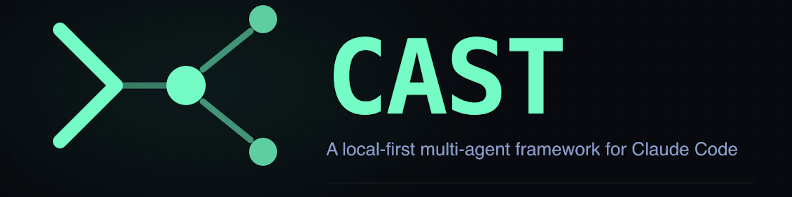

<p align="center">
  
</p>

<h1 align="center">CAST</h1>

<p align="center">
  <strong>A governance control plane for Claude Code.</strong><br>
  Claude Code keeps a transcript. CAST keeps a <em>record</em> — and then uses it.
</p>

<p align="center">
  <a href="https://github.com/ek33450505/claude-agent-team/actions/workflows/bats-ci.yml"></a>
  
  
  
  
  
</p>

<p align="center">
  <a href="docs/tutorial/getting-started.md">Quick Start</a> ·
  <a href="docs/architecture/ARCHITECTURE.md">Architecture</a> ·
  <a href="docs/agents/AGENT-ROSTER.md">Agent Roster</a> ·
  <a href="CHANGELOG.md">Changelog</a>
</p>

---

CAST is a governance layer for Claude Code. It records what your agents did and enforces what they may do next.

Every dispatch, review, truncation and cost lands in a typed SQLite schema on your machine at
`~/.claude/cast.db`: <!-- CAST_DB_TABLE_COUNT -->46<!-- /CAST_DB_TABLE_COUNT --> typed tables that CAST provisions (a long-lived database
also carries tables from older migrations). CAST reads that record back to gate commits, recall past incidents into the next prompt, attribute spend per task, and estimate a
dispatch before you make it. It is built on Claude Code's native primitives, with a roster of
<!-- CAST_AGENT_COUNT -->27<!-- /CAST_AGENT_COUNT --> specialist agents that plan, implement, review, test and commit.

Two design values shape it. It says when work is unverified: a truncated agent is flagged, not relayed as done.
And it is built to resist destroying its own runtime: two full `~/.claude` wipes (one took colocated backups
with it) and a destructive test that ran `rm -rf` from the repo root became invariants in code. The limit is
stated plainly: guards are hooks, and a session started in a mode that skips hook discovery does not get them.
See [docs/known-limitations.md](docs/known-limitations.md).

```console
$ cast status          # real layout; spend/memory values replaced with illustrative ones
CAST v10.6.1
======================================================================
Agents      27 in ~/.claude/agents/
Hooks       30 active
Spend       $12.40 today  $84.10 this week
Budget      $12.40 / $50.00 daily (24%)
Memory      1008 entries | 61 stale (confidence < 0.4) | last verified: 2026-08-26 08:13:46
======================================================================
Recent agents (last 5):
  ~ Explore                [                        ]
  + commit                 [claude-haiku-4-5-20251001] 5m ago
  + code-reviewer          [claude-haiku-4-5-20251001] 6m ago
  + frontend-writer        [claude-sonnet-5         ] 7m ago
  + test-runner            [claude-haiku-4-5-20251001] 8m ago
```

`+` is a clean `DONE`; `~` is still running; `x` is `BLOCKED` or `NEEDS_CONTEXT`. In-flight rows carry no
model or elapsed time yet. Those are written at completion, so an empty pair means *running*, not *broken*.

> **Status.** Latest release **v10.6.1** (2026-10-15). Released history: [CHANGELOG.md](CHANGELOG.md).

## See it work

Three commands, real output.

**Estimate a task from your own history.** `cast predict` aggregates past sessions that resemble this one:
the cost spread, and which agents finished similar work.

```console
$ cast predict "add a bats test for the git guard"
── Cost Prediction ──────────────────────────────────────────────────────
Tasks like this: ≈ $19.30 median  (mean $35.00, range $0.14–$254.95) over 49 similar sessions

── Suggested Agents ─────────────────────────────────────────────────────
  Suggested: commit                 (136 runs on similar tasks, 98% DONE, ≈$0.19 avg)
  Suggested: code-reviewer          (124 runs on similar tasks, 98% DONE, ≈$0.25 avg)
  Suggested: researcher             ( 94 runs on similar tasks, 65% DONE, ≈$1.93 avg)
```

**Ask the record in plain English.** FTS5 across agent runs, dispatches, transcripts, memories, incidents and
journal entries. `--semantic` adds local embeddings via Ollama; nothing leaves the machine. The index is as
large as your own retained history:
`sqlite3 ~/.claude/cast.db "SELECT kind, COUNT(*) FROM record_fts GROUP BY 1 ORDER BY 2 DESC;"`

```console
$ cast ask "wipe incident" --limit 2
memory · 2026-07-09T21:40:50 · wipe-canary-quiet-log-is-healthy
   [wipe]-canary-quiet-log-is-healthy com.cast.[wipe]-canary's StandardOutPath…

agent_run · 2026-07-09T21:40:50 · researcher · DONE
   …including `[wipe]-canary-launchd.log`. It only writes to the [incident] directory…
```

**Check the system's own state.** `cast doctor` prints one line per check and, since v10, exits non-zero when
something is actually wrong.

```console
$ cast doctor
[ok] Schema: 16/16 provisioned tables present
[ok] Hooks registered: 30 entries
[ok] Install integrity: manifest verified
[!!] Stale memories: 38 flagged (verified_at > 30 days, names specific paths/flags)
[ok] MCP servers: 3 configured, all reachable
[ok] Litestream: replica fresh (lag 0s)
[!!] Some checks need attention
$ echo $?
1
```

## What CAST adds to Claude Code

CAST is a layer over Claude Code, not a replacement for it. Most of what it does rests on features Claude Code
ships natively. Each row names the native feature first, then what CAST adds.

| Native feature | What Claude Code gives you | What CAST adds |
|---|---|---|
| [Hooks](https://code.claude.com/docs/en/hooks) | Lifecycle events delivered as JSON to your commands, and `onFailure: "block"` (Claude Code 2.1.295+): a guard hook that crashes, cannot start or times out blocks the tool call. | Recorders that write typed rows to `cast.db`, an injection path back into the next turn, and guards that block before a tool call lands. CAST adopted native `onFailure` and deleted its own Bash guard watchdogs. |
| [Subagents](https://code.claude.com/docs/en/sub-agents) | Markdown agent definitions with their own tools and model. | A <!-- CAST_AGENT_COUNT -->27<!-- /CAST_AGENT_COUNT -->-agent roster with model tiering (Haiku 16 / Sonnet 10 / Opus 1), a typed Handoff/Status contract, truncation detection. |
| [Settings](https://code.claude.com/docs/en/settings) & [permissions](https://code.claude.com/docs/en/permissions) | Allow/deny rules and layered settings files. | Path-tier command guards glob rules cannot express; agent edits to CAST's runtime and project settings denied; a `ConfigChange` guard blocks hot-reloaded `env`/`disableAllHooks`. |
| [Sandbox](https://code.claude.com/docs/en/sandboxing) | An OS-level boundary for Bash. | Guards that do not depend on it; for users who enable it, write-denies on git-executed paths and `git`, `docker`, `bq`, `osascript` removed from `excludedCommands`. |
| [Plan mode](https://code.claude.com/docs/en/common-workflows) | Plan-then-act in a single session. | Native plan mode is the default; the `planner` and `/orchestrate` chain is reserved for multi-agent work. |
| [Skills](https://code.claude.com/docs/en/skills) & [plugins](https://code.claude.com/docs/en/plugins/overview) | On-demand instruction bundles and a distribution format. | Rules moved into on-demand skills; dual-ship as a native plugin alongside `install.sh`. |
| [MCP](https://code.claude.com/docs/en/mcp) | A standard way to expose tools and data. | `cast mcp serve` exposes the record read-only. |
| [OpenTelemetry monitoring](https://code.claude.com/docs/en/monitoring-usage) | Usage and cost metrics and events, exported to your collector. | A local typed record joined across dispatches, reviews and commits, queryable with `cast ask` and `cast cost`, plus a pre-dispatch estimate from `cast predict`. |

The guards are a string-analysis, defence-in-depth layer; the sandbox is the hard OS boundary. The maintainer
runs with the sandbox off by choice, and the residuals are listed in
[docs/known-limitations.md](docs/known-limitations.md) and
[docs/architecture/enforcement-awareness-split.md](docs/architecture/enforcement-awareness-split.md).

## Why CAST exists

A record is useful when it changes the next decision, so CAST runs **record → query → inject → enforce**.
Claude Code fires structured JSON on lifecycle events; CAST writes each as a typed row, feeds relevant prior
rows back into the next turn on `UserPromptSubmit`, and blocks actions on `PreToolUse` before they land.

The design rule is: **where Claude Code ships a native primitive, adopt it and delete the bespoke version.**
Language rules became on-demand skills, the planner chain gave way to native plan mode for single-session work,
distribution moved to a native plugin, and the Bash guard watchdogs were retired for native `onFailure`. Applied
honestly, much of CAST could melt into the platform. What survives is the governance content of the record
(`dispatch_decisions`, `provenance_chain`, `quality_gates`, `injection_log`, `incidents`) and the joins across it.

## What it does

**Guards.** PreToolUse hooks block raw `git commit` and `git push`; commits go through a `commit` agent that
records provenance, and a pre-push gate checks that every commit traces to a recorded session. A command guard
blocks `rm -rf` of protected roots, `pkill`, and Bash writes into the installed exec surface
(`~/.claude/{githooks,scripts,config}`). The git guard blocks when its module cannot load or a command cannot
be analysed, and native `onFailure: "block"` covers a guard hook that cannot start or times out. Both Bash guards
still allow on an internal error inside their analysis, so a guard bug cannot block every Bash call.

**Escape hatches, recorded.** Every guarded git operation has a hatch. All 17 git hatches write an
`ack_events` row when, and only when, the hatch actually averted a block, and
`CAST_HATCH_REASON="rebasing onto main"` records why. The command-guard hatches (`CAST_KILL_OK`, `CAST_RM_OK`,
`CAST_PROTECTED_WRITE_OK`) are logged as block lines instead. Bypassing a gate is allowed; doing it invisibly
is not.

**Review.** Code changes require a fresh-context `code-reviewer` pass, enforced in the agent registry. The
commit gate reads `quality_gates` to decide whether a change was reviewed, and a rejection is sticky: a later
approval cannot silently clear it.

**Self-audit.** A `SubagentStop` hook parses each agent's typed `## Handoff`, flags truncation, and checks
claimed work against real file changes. Failures are recorded in `agent_hallucinations`, `agent_truncations`,
`hook_failures` and `agent_protocol_violations`. An install-integrity manifest
(`~/.claude/install-manifest.sha256`) is checked at every SessionStart and by `cast doctor`.

**Recoverability.** The record replicates via [Litestream](docs/backups.md) to
`~/Library/Application Support/cast/`, outside the `~/.claude` blast radius. The wipe canary runs from that
path, so it survives the event it detects. `blast-radius-lint` fails CI on a bare `rm -rf` in `scripts/`,
every test that touches `$HOME` uses a temp one, and destructive operations are tested by proving they refuse.

**Local-first.** Code, prompts, memory and the record live on your disk. There is no SaaS, no telemetry
egress and no sign-in. Cloud features (Managed Agents, local-model routing via
[claude-code-router](https://github.com/musistudio/claude-code-router)) are opt-in.

## Installation

**Prerequisites**

- Required: `git`, `python3`, the `sqlite3` CLI, and [Claude Code](https://code.claude.com/docs/en/overview) 2.1.295 or later (CAST's guard hooks rely on its `onFailure: "block"`). macOS ships python3 and sqlite3; on Debian/Ubuntu: `sudo apt-get install git python3 sqlite3`.
- Optional: bats-core ≥ 1.10 (only to run CAST's own tests; see Testing), [Litestream](docs/backups.md) (database replication), and `python3-venv` on Debian/Ubuntu (used by `cast dash`; falls back to system Python).

**Homebrew**

```bash
brew tap ek33450505/cast && brew install cast
bash "$(brew --prefix)/opt/cast/libexec/install.sh"   # sets up ~/.claude, cast.db, hooks
```

**From source**

```bash
git clone https://github.com/ek33450505/claude-agent-team.git
cd claude-agent-team && bash install.sh
```

**As a Claude Code plugin.** The plugin coexists with `install.sh` rather than replacing it.

```bash
/plugin marketplace add ek33450505/claude-agent-team
/plugin install cast@cast
/plugin enable cast@cast
```

The plugin is **opt-in** (`defaultEnabled: false`); its SessionStart bootstrap runs only after
`/plugin enable`. `install.sh` stays authoritative for the runtime layer (`~/.claude/scripts`, `cast.db`,
launchd jobs, git hooks in `~/.claude/githooks`), and when both are present the plugin's hooks defer via a
`~/.claude/config/cast-hook-owner` sentinel so nothing double-fires. The plugin ships **22 curated agents**
(`push` and `morning-briefing` are excluded); add the 3 opt-in extras with
`bash scripts/gen-plugin.sh --with-extras dist/cast-plugin`. A full `install.sh` carries all <!-- CAST_AGENT_COUNT -->27<!-- /CAST_AGENT_COUNT -->.

The installer links `cast` into `~/.local/bin`. If `cast` is not found, add
`export PATH="$HOME/.local/bin:$PATH"` to your shell profile.

Then run `cast status` to verify, and follow **[the 5-minute tutorial](docs/tutorial/getting-started.md)** to
run your first gated dispatch.

## The `cast` CLI

`cast` is one binary with **42 subcommands** (`grep -cE '^  [a-z-]+\)' bin/cast`), grouped by what they do
with the record.

| | |
|---|---|
| **Query the record** | `ask` · `predict` · `incidents` · `review` · `cost` · `budget` · `files` · `agents --usage` |
| **Enforce** | `doctor` · `integrity` · `db-contract` · `provenance` · `ledger` |
| **Run agents** | `dispatch` · `parallel` · `batch` · `exec` · `feature` · `test` · `eval` |
| **Operate** | `status` · `dash` · `hooks` · `routines` · `migrate` · `backup` · `restore` · `tidy` · `clean` |
| **Extend** | `new-agent` · `init-repo` · `rules` · `stack` · `memory` · `mcp` · `cheap` · `install-completions` |

- **`cast dash`**: a live terminal UI over running agents.
- **`cast cheap`**: route a whole session to a local model through claude-code-router + Ollama (verified on
  `qwen2.5:7b`). Opt-in and per-session; `claude` still uses the API.
- **`cast ledger`**: a signed, per-session audit receipt, re-verifiable with `--verify`.
- **`cast ci-local`**: run the PR-gating CI workflows locally via `act` before you push.
- **`cast routines`**: scheduled agent jobs (briefings, cost reports, integrity monitors) via launchd.

## Architecture

A prompt is routed by `CLAUDE.md`; **PreToolUse guards** block before a tool call lands; the **agent
registry** dispatches by model tier; **`code-reviewer`** reviews in fresh context; **SubagentStop** validates
the Handoff and writes memory; and every step appends to `cast.db`.

<p align="center">
  
</p>

Full guide: **[docs/architecture/ARCHITECTURE.md](docs/architecture/ARCHITECTURE.md)**.

## Agents

<!-- CAST_AGENT_COUNT -->27<!-- /CAST_AGENT_COUNT --> core specialists, each a markdown file in `~/.claude/agents/` with YAML frontmatter
defining model tier, memory, isolation and effort. Responses validate against JSON schemas in `schemas/`,
including the typed `## Handoff` contract. Model tiering is Haiku 16 / Sonnet 10 / Opus 1; the escalation bar
is irreversibility plus infrequency, not raw difficulty.

`frontend-writer` · `backend-writer` · `code-reviewer` · `debugger` · `planner` · `researcher` · `security` ·
`test-writer` · `commit` · `push` · `devops` · `bash-specialist` · `migration-reviewer` · `eval-writer` ·
`pr-reviewer`, and 12 more.

Ceremony matches task size: one-or-few-file work uses native plan mode with a single agent, and genuinely
multi-file work runs the `planner` → `/orchestrate` chain in waves. Full table with tiers:
**[docs/agents/AGENT-ROSTER.md](docs/agents/AGENT-ROSTER.md)**.

## Hooks

Deterministic `command`-type hooks enforce; `prompt`-type hooks advise. The lifecycle: **SessionStart**
(bootstrap, context banner, install-integrity check) → **UserPromptSubmit** (memory recall, routing) →
**PreToolUse:Bash** (commit/push/stash block, `pkill` and `rm -rf` command guard, exec-surface write guard) →
**PreToolUse:Write|Edit** (write guards, reviewer injection) → **PostToolUse** → **SubagentStop** (truncation
detection, Handoff validation, honesty sensors, memory write) → **PreCompact** (dirty-repo compaction guard)
→ **SessionEnd** (memory sync, resume scaffold). Write your own: **[docs/hooks/authoring-guide.md](docs/hooks/authoring-guide.md)**.

## The record

SQLite in WAL mode at `~/.claude/cast.db`, fully local. A retention job prunes old run rows (default 90 days,
`CAST_DB_PRUNE_DAYS`).
<!-- CAST_DB_TABLE_COUNT -->46<!-- /CAST_DB_TABLE_COUNT --> typed tables cover sessions, agent runs, routing events, quality gates,
dispatch decisions, memories, eval runs, incidents and provenance. Query it with `cast ask`, `cast predict`
and `cast cost --by-task`, or register it as a read-only stdio MCP server (`mode=ro`, no arbitrary SQL):
`claude mcp add cast-record -- cast mcp serve`.

Two read-only UIs read `cast.db` locally:
**[claude-code-dashboard](https://github.com/ek33450505/claude-code-dashboard)** (React 19 + Vite + Express)
and **[Cast Desktop](https://github.com/ek33450505/cast-desktop)** (Tauri 2 native macOS app with an embedded
PTY terminal). See [docs/observability/OBSERVABILITY.md](docs/observability/OBSERVABILITY.md).

**Memory.** Each agent keeps domain knowledge in `~/.claude/agent-memory-local/<name>/MEMORY.md` (native
auto-load), alongside a per-prompt router over the `agent_memories` table. A weekly routine decays, dedups,
archives and promotes memories, and a memory recalled often decays more slowly than one nobody reads.

## Testing

<!-- CAST_TEST_FILE_COUNT -->259<!-- /CAST_TEST_FILE_COUNT --> BATS test files (<!-- CAST_TEST_COUNT -->4776<!-- /CAST_TEST_COUNT --> test cases) cover hooks, migrations,
guard logic, event emission and memory persistence, including tests that prove destructive operations
**refuse**.

```bash
bash tests/run.sh          # the CI-glob runner
```

> **Hard rule:** every test that touches `$HOME` isolates to a temp one, and GUI side effects are stubbed.
> **Never run the suite against your real `~/.claude`.** Use `tests/run.sh`: it expands the same five-pattern
> glob CI uses, whereas plain `bats tests/` is non-recursive and silently skips every subdirectory test.

CAST needs **bats-core ≥ 1.10**, not the legacy `bats` package (`brew install bats-core` on macOS,
`npm install -g bats` on Debian/Ubuntu); see [docs/compatibility.md](docs/compatibility.md). CI covers macOS
and Ubuntu in different workflows; the badge above tracks the Ubuntu suite.

**Agent behavior is tested too.** `cast eval` runs a corpus in `evals/cases/<agent>/*.yaml` mined from real
failures (missed bugs, false `DONE`s, ignored scope), with three-outcome graders, an LLM-judge grader, and
`pass@k` for probabilistic behavior: `cast eval list && cast eval run --all && cast eval report`.

## Cost, measured honestly

`cast cost` attributes tokens and dollars per task, branch and agent, and model tiering keeps review-class
work off the expensive tier. The main-loop model defaults to `claude-sonnet-5`. Workflow, Explore, Plan
and general-purpose subagents **inherit whatever model drives the main loop**, so that one setting keeps the
largest recorded cost driver off Opus by default.

There is no frozen cost headline here: retention prunes the rows behind any rolling figure, so every number
carries its window. Measure your own, span first:

```bash
just -g window     # print the real retained span FIRST; a share means nothing without it
just -g cost       # spend by agent
just -g model-mix  # tier distribution
```

On the maintainer's record, over **2026-09-13 → 2026-10-13 (30 days, 6,135 recorded agent runs)**, cache
reads were **93.5%** of input-side tokens (input + cache read + cache creation).

CAST does not create that saving. Prompt caching is a native platform feature, and vanilla Claude Code gets it
without CAST. What CAST contributes is **legibility** (an auditable number instead of an opaque discount) and
**session shape**: slim always-on rules, demand-loaded skills and stable memory injection give a stabler
cacheable prefix. That second effect is unquantified; no controlled baseline separates it from cache hits
that would have happened anyway. See [docs/TOKEN-OPTIMIZATION.md](docs/TOKEN-OPTIMIZATION.md).

## Known limits

- **Hooks only run where hooks are discovered.** A session started in a mode that skips hook discovery
  (for example `claude --bare`) bypasses the guards and recorders.
- **Guards are string analysis.** They are defence in depth; the sandbox is the hard OS boundary.
- **The Bash guards (git and command) allow on an internal error in their analysis**, so a guard bug cannot
  block every Bash call. A guard hook that cannot start or times out still blocks.
- **Native `onFailure: "block"` needs Claude Code 2.1.295 or later.** Older versions do not block on a
  crashed or timed-out guard hook.
- **macOS-first.** launchd jobs and the Litestream replica path are macOS-specific; Ubuntu is covered in CI.
  On Linux, backups still go to `~/Library/Application Support/cast` (no XDG path yet), and no backup job is
  scheduled, so run `cast backup` yourself.

Full list, with what still holds in each case: [docs/known-limitations.md](docs/known-limitations.md).

## Documentation

| Guide | What's in it |
|---|---|
| [Tutorial](docs/tutorial/getting-started.md) | Install, verify, run your first gated dispatch |
| [Architecture](docs/architecture/ARCHITECTURE.md) | Control plane, enforcement, data-integrity stack, evals |
| [Agent Roster](docs/agents/AGENT-ROSTER.md) | All <!-- CAST_AGENT_COUNT -->27<!-- /CAST_AGENT_COUNT --> agents with model tiers and scope |
| [Backups & Recovery](docs/backups.md) | Litestream, off-radius snapshots, `cast integrity` |
| [Hook Authoring](docs/hooks/authoring-guide.md) | Write, test and install custom hooks |
| [Observability](docs/observability/OBSERVABILITY.md) | cast.db schema and the dashboards |
| [Routines](docs/routines.md) | Scheduled agent jobs — briefings, cost reports, integrity monitor |
| [Compatibility](docs/compatibility.md) | Claude Code version requirements and known breakages |
| [Known Limitations](docs/known-limitations.md) | What CAST cannot do, and why |
| [Full Docs Index](docs/README.md) | Everything, with one-line descriptions |

CAST ships <!-- CAST_COMMAND_COUNT -->21<!-- /CAST_COMMAND_COUNT --> slash commands and <!-- CAST_SKILL_COUNT -->19<!-- /CAST_SKILL_COUNT --> on-demand skills.

## Ecosystem

CAST is the core of a connected set of open-source repositories, each solving one piece of the multi-agent
workflow problem.

<!-- ECOSYSTEM_START -->
| Tier | Repos |
|---|---|
| Observability | claude-code-dashboard, cast-desktop |
| Record extractions | cast-mcp, cast-ledger, cast-predict |
| Tooling | cast-memory, cast-doctor, cast-time, cast-claudes_journal |
<!-- ECOSYSTEM_END -->

Full table and install commands: **[docs/ecosystem.md](docs/ecosystem.md)**.

## Contributing

Contributions are welcome. New agents, shell fixes, BATS coverage and documentation improvements are all fair
game. Please open an issue before non-trivial changes, and read **[CONTRIBUTING.md](CONTRIBUTING.md)** for the
workflow (including how to regenerate the plugin artifact).

Questions and ideas: **[GitHub Discussions](https://github.com/ek33450505/claude-agent-team/discussions)**.

## License

MIT — see [LICENSE](LICENSE).

Built and maintained by **[Edward Kubiak](https://github.com/ek33450505)**, full-stack engineer. CAST is the
system I wanted for building software with Claude Code every day, so I built it, broke it, and hardened it.
[edwardkubiak.com](https://edwardkubiak.com)
